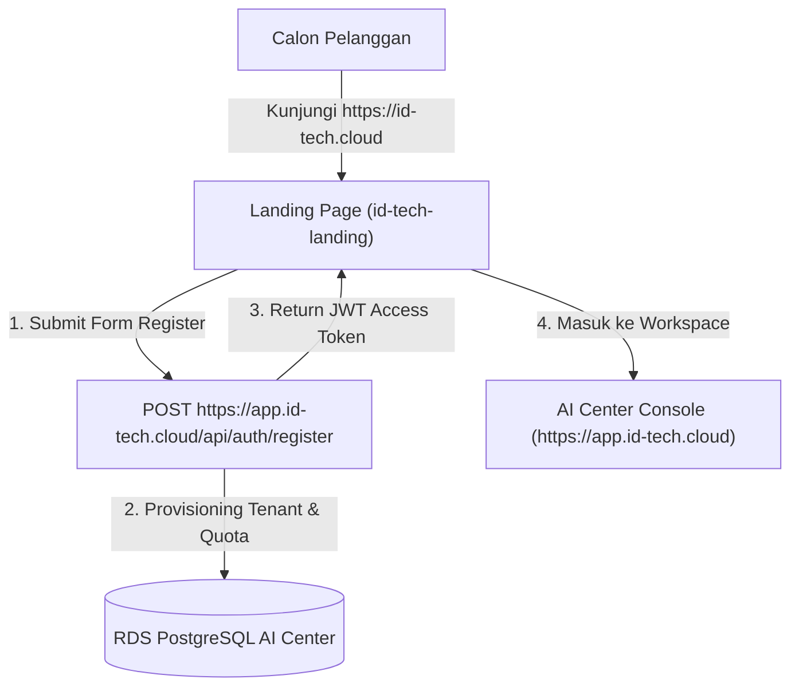

# ID-Tech Cloud — Official Landing Page & Customer Portal 🚀

Website Pemasaran Resmi & Portal Pendaftaran Pelanggan untuk **ID-Tech Cloud** (`https://id-tech.cloud`).

## 🌟 Ikhtisar Arsitektur
Proyek ini memisahkan secara bersih (*separation of concerns*) antara **Halaman Pemasaran Publik & Konversi Penjualan** dengan **Core AI Center Engine**.



- **Domain Utama (`https://id-tech.cloud`)**: Landing page ini (SEO optimized, PageSpeed 100/100, kalkulator ROI, pricing table, dan form pendaftaran 1-click).
- **Subdomain Console (`https://app.id-tech.cloud`)**: Core AI Center Workspace tempat operator dan pelanggan mengendalikan swarm AI.

---

## 🛠️ Tech Stack
- **Framework**: React 19 + TypeScript
- **Bundler & Dev Server**: Vite 8
- **Styling**: Tailwind CSS v4 + Glassmorphism Dark UI
- **Icons**: Lucide React
- **Typography**: Plus Jakarta Sans & JetBrains Mono

---

## 🚀 Panduan Menjalankan

### 1. Instalasi Dependensi
```bash
npm install --legacy-peer-deps
```

### 2. Development Mode
```bash
npm run dev
```

### 3. Production Build
```bash
npm run build
```
Hasil build static file akan tersimpan di direktori `dist/`.

---

## 🌐 Konfigurasi Environment (`.env`)
Buat file `.env` di root proyek:
```env
# URL API Backend AI Center
VITE_API_URL=https://app.id-tech.cloud/api

# URL Portal Console AI Center
VITE_APP_CONSOLE_URL=https://app.id-tech.cloud
```

---

## ☁️ Rekomendasi Deployment
Direktori `dist/` dapat di-deploy secara instan dan gratis ke:
1. **Cloudflare Pages** (Sangat direkomendasikan karena domain sudah di Cloudflare):
   - Build command: `npm run build`
   - Build output directory: `dist`
2. **Vercel** / **Netlify** / **Railway Static Site**

---

## 📄 Lisensi
Hak Cipta © 2026 PT NexGen Digital Nusantara. Semua hak dilindungi undang-undang.
